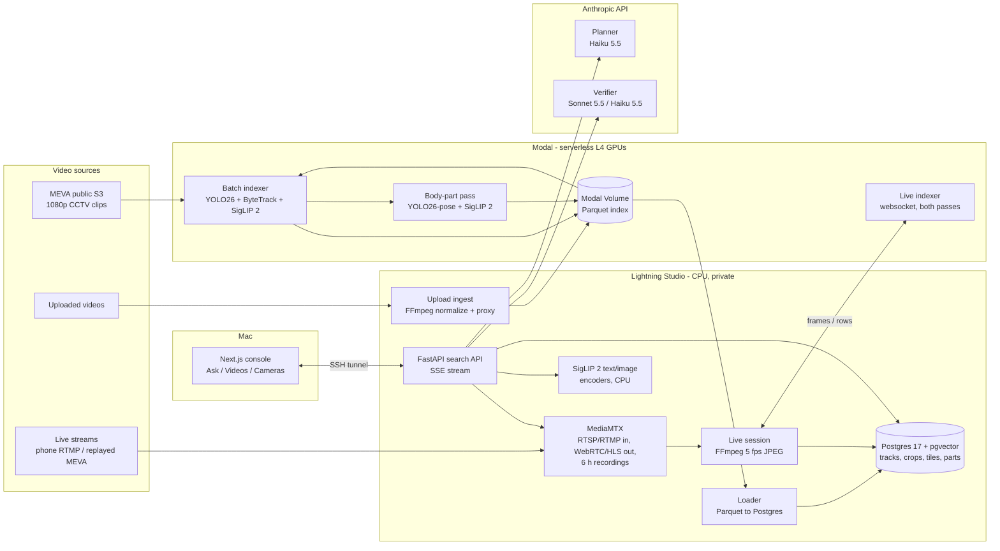

# godsEye: Architecture

How the MVP works today, component by component, as built in this repo: what is shipped, what is
designed but not built yet, and where each piece lives.

**What it does.** Natural-language **search** over recorded, uploaded and live video ("a man in a red
Nike t-shirt", "someone with a tattoo on his right hand", "a person texting", a photo of a person).
**Monitor** (natural-language alert rules) and **Analyze** (counting) are designed
but not built yet.

---

## 1. System map



| Piece | Runs on | Code |
|---|---|---|
| Batch, part and upload indexing; live GPU worker | **Modal**, one L4 container per camera or stream | `services/indexer/index_app.py`, `pipeline.py`, `parts.py`, `live.py`, `geometry.py` |
| Postgres + pgvector, MediaMTX, Redis, search API, loader, upload ingest, live sessions | **Lightning AI Studio** (free CPU; L4 when needed), nothing exposed to the internet | `services/api`, `services/search`, `services/ingest`, `services/live`, `services/db`, `infra/studio` |
| Query planner and result verifier | **Anthropic API** | `services/search/llm.py` |
| Web console | **Mac**, `npm run dev`, reaches the Studio through `make tunnel` | `apps/web` |
| Evaluation | Studio | `scripts/spike` |

---

## 2. Components and models

| Layer | Component | Settings | Why |
|---|---|---|---|
| Decode | PyAV (FFmpeg), CPU thread | every 6th frame of 30 fps = 5 fps; 160×90 grey copy for motion | Decode once, feed detection and embedding |
| Detection | **Ultralytics YOLO26m** | 1280 px input, conf 0.2, FP16, batch 16, 10 COCO classes (person, bicycle, car, motorcycle, bus, truck, backpack, umbrella, handbag, suitcase) | CCTV wide shots: small people need a large input |
| Tracking | **ByteTrack** (`supervision`) | 5 fps, activation 0.25, lost buffer 4 s, 2 frames to confirm | Fixed cadence, never motion-gated, so trajectories are complete |
| Embedding | **SigLIP 2 so400m patch16-384** (`google/siglip2-so400m-patch16-384`) | FP16 on GPU, images padded to square, 1152-d, L2-normalized | One space for text queries, photo queries and footage |
| Pose | **YOLO26l-pose** (index), **YOLO26s-pose** (photo search, CPU) | top-down on person crops, 512 px | Keypoints locate hands, head, torso, legs, feet |
| Vector store | **Postgres 17 + pgvector** | `halfvec(1152)`, HNSW (`halfvec_ip_ops`) on crops and tiles, exact scan on part views | One database for vectors, tracks and time filters |
| Planner | **Claude Haiku 5.5** | structured output (`Plan`), thinking off, low effort | Splits a question into conditions at their scale |
| Verifier | **Claude Sonnet 5.5** for appearance and close-ups, **Haiku 5.5** for activities | structured output (`Judgment`), per-condition answers | Sonnet is consistent on details at the limit of the pixels |
| Video server | **MediaMTX** | RTSP :8554, RTMP :1935 (publish password), WebRTC :8889, HLS :8888, playback :9996, fMP4 recordings in 10 s segments kept 6 h | Live view, phone ingest, replay of live footage |
| Process manager | **process-compose** | postgres → db-init → api; redis; mediamtx | Restarts, readiness, ordered start on the Studio |
| API | **FastAPI** + uvicorn | server-sent events for search | Results stream in as each stage finishes |
| Console | **Next.js 16**, React 19, Tailwind 4, motion, Phosphor icons | pages: Ask (`/`), Videos, Videos/[camera], Cameras | Query bar, interpretation chips, staged results, player with tracked box |
| Serverless GPU | **Modal** | L4, 8 CPU, 16 GB; volume `godseye-index`; Dict `godseye-progress` | Pay per second; one container per camera in parallel |

---

## 3. Indexing

Every source ends up as the same four tables. A camera's clips are processed **as one continuous
stream in time order**: tracker state carries across the 5-minute files, and a recording gap over 2 s
resets the tracker.

### 3.1 First pass: tracks, crops and scene tiles (`pipeline.py`)

```
clips ──download (6 threads)──► decode thread ──5 fps frames──► batches of 16
   │
   ├─ Loop A, every frame:  YOLO26m ─► ByteTrack ─► tracks + trajectories (normalized cx, cy, w, h per point)
   │                          └─► track crops: on first sight, then every 2 s while moving (10 s when still),
   │                              at most 12 per track, ≥16 px, 15% padding; plus the best crop (conf × area)
   │
   └─ Loop B, change-driven: full frame + four overlapping 60% tiles, at most every 2 s while the
                             scene changes (mean grey difference > 2), at least every 30 s otherwise
   │
   ▼
SigLIP 2 in batches of 64 ─► tracks.parquet, crops.parquet, frames.parquet, stats.json
```

The three retrieval units cover each other's misses: **track crops** carry the look of
people and vehicles, **tiles** catch small objects and anything the detector has no class for, and
(designed, not built) **captions** would carry actions and relations.

### 3.2 Second pass: body-part close-ups (`parts.py`, `geometry.py`)

A hand is ~3% of a person crop, so a tattoo or a watch vanishes in the person-level embedding.

```
tracks.parquet + native 1080p frames
   ─► every tracked person ≥160 px tall, 12% padding ─► YOLO26l-pose (top-down)
   ─► part boxes from keypoints: left/right hand (elbow to fingertips), head, torso, legs, feet
      (sides are the person's own, COCO convention)
   ─► best view per part per second, scored by size × keypoint confidence × sharpness (Laplacian variance)
   ─► dropped if below a native size floor (hand 52 px, head 40, torso 56, legs 40, feet 40)
      or nearly identical to the last kept view (cosine > 0.96); at most 60 per person and part
   ─► SigLIP 2 ─► parts.parquet (JPEG ≤320 px + embedding)
```

### 3.3 Three ways footage gets indexed

| Path | Flow | Where the rows go |
|---|---|---|
| **Batch** (MEVA) | `modal run services/indexer/index_app.py` fans out one L4 per camera; `--parts` runs the second pass; Parquet is fetched to the Studio and loaded by `load.py` | run `spike` |
| **Upload** (`services/ingest/uploads.py`) | browser → API → FFmpeg on the Studio (rotation, 30 fps H.264 ≤1080p for indexing, 720p 15 fps proxy, thumbnail) → Modal Volume → `index_upload` runs both passes on one L4, reporting progress to a Modal Dict → Parquet back → Postgres | run `uploads`, camera `U-xxxxxx` |
| **Live** (`services/live/session.py`, `indexer/live.py`) | MediaMTX RTSP → FFmpeg 5 fps JPEGs → authenticated websocket → Modal `Live` class (both passes per ~1 s batch) → new and changed rows back → upserted into Postgres, searchable at once. At most 10 frames in flight; newer frames are dropped rather than queued, so results stay seconds behind live. Stops after 2 h or when the stream ends; the GPU container scales down 60 s later | run `live-<start time>` |

### 3.4 Storage (`services/db/schema.sql`)

| Table | One row per | Key columns | Index |
|---|---|---|---|
| `tracks` | tracked person or object | class, start/end, trajectory (`traj_dt_ms`, `traj_xywh`), best JPEG | (camera, start, end) |
| `track_crops` | crop of a track | ts, bbox, JPEG, `halfvec(1152)` | HNSW, inner product |
| `frame_embeds` | full frame or tile | ts, tile 0-4, box, motion, thumbnail, `halfvec(1152)` | HNSW, inner product |
| `part_crops` | close-up of a body part | part, side (L/R), ts, box, native px, quality, JPEG, `halfvec(1152)` | exact scan (~19k rows) |

**Parquet is the source of truth.** Postgres lives on the Studio's local disk and is rebuilt from
`~/data/index` on every start (`db-init`, about a minute), so stopping the Studio loses nothing.

---

## 4. Search (query time)

`services/search/service.py` is shared by the API and the evaluation scripts, so what is measured is
what ships. Each stage is streamed to the console as soon as it is ready.

```
question ─┬─► SigLIP 2 text tower (CPU) ─► kNN over crops + tiles ─────────────► provisional results
          └─► Haiku planner (in parallel) ─► Plan ────────────────────────────────► interpretation
                                              │
          appearance or close-up conditions   │   activities, untracked things
          ▼                                   ▼
   attribute search                      scene search with the plan's phrase,
   (every track scored exactly           cameras and time window
    on every condition)                       │
          └──────────────┬────────────────────┘
                         ▼
                collapse fragments ─► top 20 ─► evidence (per intent) ─► verifier ─► verdicts stream out
```

### 4.1 Planner (`llm.py`, `Plan`)
Turns the question into: **subject** (person / vehicle / bag / other), a one-line **object phrase**,
up to five **attributes**, each one visual condition tagged with its **scale** (whole, head, torso,
hand, legs, feet) and, for hands, the person's own **side**; an **activity**; an **intent** (appearance,
state, action, count); and camera and time restrictions only when the question asks for them.
"A man in a red Nike t-shirt" becomes *a man* (whole), *a red t-shirt* (whole), *a Nike logo on a
shirt* (torso).

### 4.2 Retrieval (`retrieve.py`)
- **Scene search** (`search`): kNN over `track_crops` and `frame_embeds` (k=300, `ef_search` 400,
  iterative scan so filters don't starve results). Crop hits group into track events; tile hits on one
  camera within 3 s merge into time windows (±1 s). The two lists are fused with **reciprocal rank
  fusion** (k=60).
- **Attribute search** (`search_attributes`): for each condition, every track of the subject's classes
  gets its **best view, exactly**: whole-object crops, or that body part's close-ups (the other hand
  scores slightly lower, since pose can swap sides). Similarities are **standardized per condition**
  and combined as **mean + min of the z-scores**, so a candidate has to meet every condition, not one
  very well. A missing close-up (too far away) counts as clearly below average. The result's moment is
  the best view of the most specific condition.
- **Collapse**: one parked car tracked in 17 pieces is one result. Pieces merge when they are on one
  camera, in the same place (IoU ≥ 0.4), never on screen together, and look nearly identical (mean crop
  embedding cosine ≥ 0.95); duplicate ids for one object at once (IoU ≥ 0.8, cosine ≥ 0.98) merge too.

### 4.3 Evidence (`evidence.py`, `strips.py`)
Chosen by intent, cut from the 1080p originals (or the live recording) with the candidate outlined:

| Intent | Evidence |
|---|---|
| appearance | 3 stored crops + one zoomed full-resolution frame |
| state (ongoing: texting, sitting) | 4 zoomed frames 1 s apart |
| action (brief change: opening a door) | 8 zoomed frames 0.5 s apart, cropped to where the candidate moves |
| any condition on a body part | that part's best 4 close-ups, ranked against the condition (asked-for side first), ≥0.9 s apart, upscaled to 384 px |
| always, last | the whole scene |

### 4.4 Verifier and verdict (`llm.py`, `decide`)
Evidence building (4 workers) and verification (10 workers) overlap: each candidate goes to the model
as soon as its images are ready. The verifier answers **every condition** with yes / maybe / no /
not visible, which is what stops "a red top and a grey backpack" passing for "a red backpack".
The verdict follows mechanically: all yes is a **match**, any no is a **rejection**, otherwise it is
**possible** when every key condition (the close-up detail, the activity, the person in the photo) is
yes or maybe. A refusal or transient API error degrades to "unverified"; a configuration error raises.

### 4.5 Photo search (`photo.py`)
Photo → YOLO26s-pose on CPU → the people in it (largest first) → crops of the chosen person (whole,
head, torso, legs, feet) → SigLIP 2 image tower → each crop is one condition in attribute search, with
words in the question adding more. Sonnet compares the reference photo with each top candidate.
Appearance only (clothes, shoes, bags, hair, build); **no face recognition**.

---

## 5. Serving and the console

- **API** (`services/api/main.py`): `/search` (SSE: provisional, plan, matched, verdict…, done),
  media endpoints for crops, tiles and part views, `/playback` and `/video` (byte-range 720p proxies),
  `/footage`, `/events/{id}/boxes` (the player draws the tracked box over time), `/live` and
  `/live/{path}/index` (start and stop live indexing), `/live-video` (MP4 window from MediaMTX's
  recording), `/sources` (uploads), `/photos` (photo search). CORS allows only `localhost:3000`.
- **Transport**: nothing on the Studio is reachable from the internet. `make tunnel` forwards the API,
  HLS, WebRTC and, for the phone, RTMP on the Mac's Wi-Fi address, and reconnects when Lightning's SSH
  gateway drops it.
- **Console** (`apps/web`): Ask (query bar with photo attach, interpretation chips, results that move
  from first results to verified and possible, rejected folded away, shareable `/?q=` links), Videos
  (upload with per-step progress, watch any camera or upload), Cameras (live WebRTC wall, **Index live**).

---

## 6. Evaluation (`scripts/spike`)

| Script | Measures |
|---|---|
| `eval_retrieval.py` | moment retrieval on 20 MEVA-labeled activity queries, strict matching (same camera, moment inside the labeled interval ±2 s, actor-box IoU ≥ 0.3); `--verify` adds planner and verifier |
| `eval_general.py` | 28 open questions MEVA doesn't label (clothing, head, torso, hands, feet, objects, vehicles, combinations), judged by eye in `judgments.json` |
| `mine_details.py`, `eval_details.py` | tattoo ground truth mined from every hand view, then recall per phrasing |
| `show_evidence.py`, `show_parts.py`, `show_detail_evidence.py` | contact sheets of what retrieval and the verifier see |

**Headline numbers** : 6.5 camera-hours indexed in 1.23 GPU-hours (5.3× realtime, ~$1.60,
plus ~$0.60 for the part pass); verified precision **0.96** on the 28 general questions; tattoo
recall 0.6-1.0 with no false positives; activity queries vP@5 0.37. On the free CPU the first results
arrive in under 1 s and the first verified result in ~4.5-6.5 s.

---

## 7. Designed, not built yet

| Item | Status |
|---|---|
| Loop C captions (Haiku descriptions of ~10 s windows, full-text index) | designed, not in code |
| YOLOE-26 open-vocabulary grounding before verification | designed, not in code |
| **Monitor**: rule templates (`zone_enter`, `line_cross`, `dwell`, `stopped`, `unattended_object`, `count_threshold`, `open_vocab`) compiled from natural language | designed, not in code |
| **Analyze**: counting with explicit units | designed, not in code |
| Fully local reasoning (local VLM planner, verifier, captioner) | planned, not measured |
| Cross-camera re-identification, video-native embeddings, ONVIF/VMS connectors, webhooks, RBAC, audit log | planned |
| Redis | started by process-compose, not used by any code yet |

---

## 8. Known limits

- Activities that need motion score lowest (car turning, putting an object down): evidence strips are
  centered on the frame that best *looks* like the query, not on when the action happens.
- People under 160 px tall get no close-ups; pose can swap left and right for people facing away.
- Query latency on the free CPU is dominated by FFmpeg strip building and the CPU text encoder; L4
  latency is still to be measured.
- Every query needs the Anthropic API today, so the system is not yet air-gapped.

## 9. Licences

Ultralytics YOLO26 is **AGPL-3.0** (used unmodified as a library; modifying it or offering it to outside
users brings AGPL obligations or needs an enterprise licence). SigLIP 2 is Apache-2.0. MEVA is CC BY 4.0 and must be
credited in the UI and any write-up.
