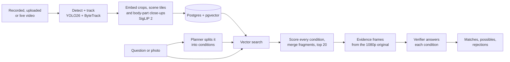

# godsEye

**Ask your CCTV footage a question in plain words, and get back the moments that answer it, each one checked.**

> "a man in a red Nike t-shirt" · "a man with a tatoo" · "a black SUV" · "a person texting" · *or a photo of a person*

godsEye indexes recorded, uploaded and live video, then answers natural-language questions about it. It
returns the exact moments on the exact cameras, with the person or vehicle outlined. Every result is
checked by a vision model, condition by condition, before it is shown as a match.

<!-- DEMO: add a 30-60 s screen recording or GIF here, e.g.

-->

## What it does

- **Search by description.** Clothing, colours, bags, vehicles, activities, and combinations of them.
- **Search by photo.** Attach a photo of a person to find where they appear. It matches **appearance only**
  (clothes, shoes, bags, hair, build). There is **no face recognition**, by design.
- **Find small details.** "A tattoo on his right hand", "someone wearing glasses", "a logo on their shirt".
  A separate pass indexes close-ups of hands, heads, torsos, legs and feet, because a hand is only about 3%
  of a person crop and vanishes in a whole-person embedding.
- **Upload a video** and search it a few minutes later. A 90-second clip took about 5 minutes end to end.
- **Search live streams.** Any RTSP/RTMP camera, or a phone used as one. Frames are indexed 5 times a
  second, about a second behind live, and are searchable while the stream runs.
- **See why a result matched.** The console shows how the question was interpreted, then streams results
  from first guesses to verified matches, with a yes / maybe / no for every condition.

## How it works

1. **Indexing.** Video is decoded at 5 fps. YOLO26 detects people, vehicles and bags, and ByteTrack follows
   them over time. SigLIP 2 embeds three kinds of views that cover each other's misses: crops of each
   tracked object, full frames and overlapping scene tiles (for small or unlabelled things), and pose-based
   close-ups of body parts. Batch indexing fans out to one serverless L4 GPU per camera on Modal.
2. **Planning.** A small LLM turns the question into separate visual conditions, each at its own scale.
   "A man in a red Nike t-shirt" becomes *a man* (whole person), *a red t-shirt* (whole person) and *a Nike
   logo on a shirt* (torso close-up).
3. **Retrieval.** Every candidate is scored on every condition. Scores are standardised and combined as
   *mean + minimum*, so a candidate has to meet all the conditions rather than one of them very well.
   Fragments of one object (a parked car tracked in 17 pieces) are merged into one result.
4. **Verification.** For the top candidates, godsEye cuts evidence from the full-resolution footage. That
   means crops for appearance, frame strips for actions, and close-ups for details. A vision model answers
   each condition separately. That is what stops "a red top and a grey backpack" passing for "a red
   backpack".

The full design, with every setting and the reason for it, is in [ARCHITECTURE.md](ARCHITECTURE.md).

## Results

Measured on [MEVA](https://mevadata.org/), a public CCTV dataset (school site, 13 cameras, 6.5 camera-hours):

| | |
|---|---|
| Indexing speed | 6.5 camera-hours in 1.23 GPU-hours: **5.3× faster than real time**, about $2.20 including the body-part pass |
| Precision on 28 open-ended questions (clothing, objects, vehicles, combinations) | **0.96** verified precision |
| Detail search ("a tattoo on the right hand") | recall **0.6-1.0** depending on phrasing, **no false positives** |
| 20 labelled activity queries, verified precision at 5 | **0.37** (up from 0.26 with a stronger verifier) |
| Latency on a free CPU machine | first results in **under 1 s**, first verified result in **~4.5-6.5 s** |

Activities that depend on motion (a car turning, putting an object down) are the weakest category today.
The known limits are listed in [ARCHITECTURE.md §8](ARCHITECTURE.md#8-known-limits).

## Stack

Python · FastAPI · Postgres 17 + pgvector · Ultralytics YOLO26 and YOLO26-pose · ByteTrack · SigLIP 2 ·
Claude (Haiku as planner, Sonnet as verifier) · Modal serverless L4 GPUs · MediaMTX (RTSP/RTMP in,
WebRTC/HLS out) · FFmpeg · Next.js 16 + React 19 + Tailwind 4

## Status and what's next

godsEye is a working MVP, built solo. Search over recorded, uploaded and live video works end to end.
Next:

- **Monitor:** alert rules written in plain words ("someone stays near gate 3 for more than 5 minutes",
  "a bag left unattended"), compiled to zone, line-crossing, dwell and unattended-object rules.
- **Analyze:** counting questions with explicit units.
- **Fully offline:** local models for planning and verification, so it can run air-gapped on-premises,
  which ports and defence sites need. Today every query calls the Anthropic API.

## Repository

| Path | What |
|---|---|
| `services/indexer` | detection, tracking, embedding and body-part passes (batch, upload and live), run on Modal |
| `services/search` | planner, retrieval, evidence and verifier: the search pipeline |
| `services/api` | FastAPI search API (server-sent events) and media endpoints |
| `services/ingest`, `services/live` | video upload processing and live-stream sessions |
| `services/db` | database schema |
| `apps/web` | the Next.js console: Ask, Videos, Cameras |
| `scripts/spike` | evaluation scripts behind the numbers above |
| `infra/studio` | server setup and process management |

To run it yourself, see [docs/RUNBOOK.md](docs/RUNBOOK.md).

## Credits and licences

- Footage: the **MEVA** dataset (Kitware / IARPA DIVA), CC BY 4.0.
- Ultralytics YOLO26 is AGPL-3.0, used unmodified as a library. SigLIP 2 is Apache-2.0.
- No open-source licence is granted for this repository's own code yet.
